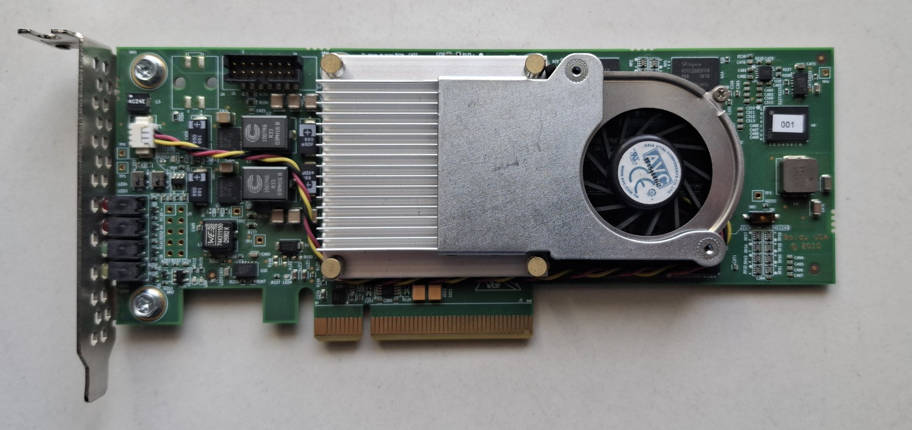
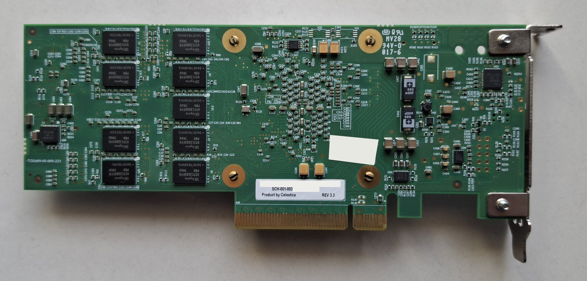

# Celestica / Baidu XC7K480T FPGA card: open-source bring-up, DDR3, PCIe and an LLM accelerator

This repository is for people who have one of these second-hand FPGA accelerator cards and want to make it do
something, with **open-source tools only** (no Vivado). It contains everything we found while bringing one up:
the pinout and board quirks, a working DDR3 recipe for both memory channels, a PCIe x8 endpoint built without
Xilinx IP, a matrix-vector accelerator that runs a 5-billion-parameter language model, and the bugs we hit in the
open-source tools on the way (with patches).

| Front | Back |
|---|---|
|  |  |

<sub>The back photo has a seller's sticker and the board's serial number blanked out.</sub>

## What works

All of this was measured on a real card (October–November 2026).

| | Result |
|---|---|
| Loading designs | JTAG (Digilent HS3) at 30 MHz, ~6 s per bitstream; the factory design in flash is never touched |
| Board health | Temperature/voltages over JTAG; 9-min soak clean; full 64 MB flash backup (read-only) |
| First designs | LEDs; a JTAG calculator and a 1024-bit multiplier needing no board pins; a RISC-V CPU (minirv) |
| DDR3 | **Both channels, 4 GiB**, 8 byte lanes each, LiteX/LiteDRAM, 600–640 MT/s; full-memory BIST, 0 errors |
| PCIe | **Gen1 x8 link** with a PC, our own config space and BAR0, 0 link errors; weight upload 33.6 MB/s |
| LLM accelerator | Two matrix-vector engines (one per DDR3 channel) + an on-card FFN unit, 4-bit weights, **bit-exact** with a PC reference |
| MustaqiLLM 5.17B (Uzbek) | **0.31 s per token** (≈3.2 tokens/s); 2.5 GB of weights live on the card |
| NeuronLM-103M (Uzbek) | **17 ms per token** (≈58 tokens/s); sits in DRAM next to MustaqiLLM |

Not working or not done: DDR3-800 (this PHY tops out around 667 MT/s), PCIe Gen2 (the transceivers run at
5 GT/s, the link is kept at Gen1), MMCM phase-shifted clocks (we use PLLs).

## The card

| Item | Details |
|---|---|
| Board | Celestica **DU-PCB-001-003** (also sold as Baidu SCH-001-003); FPGA pinout = **YPCB-00338-1P1** |
| FPGA | **XC7K480T-2FFG1156I** (Kintex-7, 478k logic cells, 1,920 DSPs, 34 Mb block RAM), IDCODE `0x23751093` |
| Memory | Two independent DDR3 channels, 64 bit + an ECC byte lane each, 2 GiB per channel (18 × SK hynix H5TC2G83FFR, 2 Gbit x8); **no data-mask pins** |
| Host interface | PCIe x8 edge connector (Gen2 capable); transceiver quads 115 + 116, refclk MGTREFCLK0_116 |
| Configuration | Master BPI x16 from a 64 MB parallel NOR flash (factory design at address 0) |
| JTAG | 2×7 2 mm header; we used a Digilent JTAG-HS3 |
| Clocks | 200 MHz differential (AH27/AH28 and G25/G26), 50 MHz (AA28), 100 MHz PCIe refclk |
| As shipped | Enumerates as PCIe device `10ee:7028` (no Linux driver binds to it) |

Details, pins and measurements: [docs/board.md](docs/board.md).

> **Read this first if your bitstreams "don't work".** Open-source bitstreams never finish configuring on this
> card (DONE stays low) unless every **unused pin is set to no pull resistor**. nextpnr leaves unused pins
> pulled down, and some pin on this board stops the startup when pulled low. Run `tools/unused_pins.py` between
> nextpnr and fasm2frames. Every build script here does.

**Safety:** never remove the card while the PC is on. Back up the flash before you ever write it (we never did
write it). Only drive pins you have verified. Loading a design over JTAG changes only the FPGA's RAM: to return to
the factory design, run `openFPGALoader -c digilent_hs3 -r`, or power-cycle the PC.

## Getting started

1. Install the toolchain and check the board: [docs/getting-started.md](docs/getting-started.md)
   (yosys, nextpnr-xilinx, Project X-Ray, openFPGALoader, LiteX; the patches you need).
2. First designs without board pins: `calc/` (JTAG calculator, big-number multiplier).
3. LEDs and pins: `pins/blink`, `pins/board.xdc` (the full constraint file, all pins).
4. A LiteX SoC with DDR3: `litex/build.sh` → [docs/ddr3.md](docs/ddr3.md).
5. PCIe: [docs/pcie.md](docs/pcie.md) (first generate its settings from your own card's factory design).
6. The language models: [docs/llm-accelerator.md](docs/llm-accelerator.md), then
   `mustaqi/fpga_chat.sh` (MustaqiLLM) or `mustaqi/fpga_chat.sh --model neuronlm`.

## Documentation

| | |
|---|---|
| [docs/board.md](docs/board.md) | Hardware facts, pinout, clocks, LEDs, flash layout, health measurements |
| [docs/getting-started.md](docs/getting-started.md) | Toolchain installation, build flow, first designs, troubleshooting |
| [docs/ddr3.md](docs/ddr3.md) | DDR3 on both channels: what was wrong and the working recipe |
| [docs/pcie.md](docs/pcie.md) | PCIe x8 without Vivado: transceivers, hard block, hold delays, Linux side |
| [docs/llm-accelerator.md](docs/llm-accelerator.md) | The matrix-vector engines, the FFN unit, both models, speed history |
| [docs/toolchain-bugs.md](docs/toolchain-bugs.md) | Bugs in the open-source tools, workarounds, upstream status |
| [docs/lessons.md](docs/lessons.md) | Practical lessons (timing estimates, memory use, testing pitfalls) |
| [docs/engineering-log.md](docs/engineering-log.md) | The full dated lab notebook: every experiment and result |
| [patches/](patches/) | Our changes to yosys, nextpnr-xilinx, prjxray and openFPGALoader |

## Bugs we found in the open-source tools

We hit ten problems in the tools; several are already fixed upstream, the rest are marked open below. Full details
and workarounds: [docs/toolchain-bugs.md](docs/toolchain-bugs.md).

| Tool | Problem | Upstream |
|---|---|---|
| yosys 0.52 | RAMB36 72-bit parity typo | fixed in 0.65 |
| nextpnr-xilinx | RAMB36 72-bit write width; BRAM output-register clock never connected | fixed in openXC7/nextpnr |
| nextpnr | GT `CPLLREFCLKSEL` disconnected → transceiver PLL can't lock | **open** (PR #83) |
| nextpnr | Internal VREF always 0.675 V, wrong for SSTL15 (1.5 V) | **open** (related #20) |
| LiteDRAM | tRFC given in clock cycles: refresh far too long below DDR3-1600 | **open** |
| litex-boards | Wrong PCIe lane-6 pin in `ypcb_00338_1p1` | fixed |
| openFPGALoader | `--read-xadc` refused on Kintex-7 | **open** (1-line fix) |
| Project X-Ray | No build with GCC 15 | PR #2556 open |
| prjxray-db | No Kintex-7 GTX interface routing bits | **open**: we derived them |

## Repository layout

```
tools/       board helpers: unused_pins.py (required build step), soak monitor, bitstream/FASM decoders
pins/        board.xdc (all pins), LED blink test, pin scan, read-only flash dump design
calc/        first designs: JTAG calculator + 1024-bit multiplier (no board pins needed)
tests/       small hardware tests: BRAM init, LUT-RAM, MMCM/PLL phase
minirv/      a small RISC-V CPU (Verilog) running on the card, with its Verilator testbench
litex/       LiteX SoC for the card (ypcb_soc.py), DDR3 bring-up and test tools, PCIe bridge, build scripts
pcie/        PCIe x8: transceiver loopback (s1), link + config space (s2), the core (core/), DB overlay (db/)
accel/       matrix-vector engine, FFN unit (Verilog), LiteX wrappers, golden C model, simulations
mustaqi/     host software: chat app, model forward pass, PCIe/JTAG links, weight export, C reference
neuronlm/    the second model: export, PyTorch reference, quality test
llm/chat.py  JTAG upload helper (used by litex/dram.py)
patches/     toolchain patches
docs/        documentation
```

Model weights, bitstreams and build outputs are not in the repository; the scripts download or build them
(see the docs). The scripts assume this repository is cloned to `~/celestica` and the tools are installed under
`~/tools` as described in [docs/getting-started.md](docs/getting-started.md).

## Credits and licences

- Our code and documentation: MIT licence ([LICENSE](LICENSE)).
- The YPCB-00338-1P1 pinout started from [TiferKing/ypcb_00338_1p1_hack](https://github.com/TiferKing/ypcb_00338_1p1_hack)
  and the litex-boards `ypcb_00338_1p1` target; we verified it against the card's factory design.
- Tools: [openXC7](https://github.com/openXC7) (nextpnr-xilinx, prjxray-db), [Project X-Ray](https://github.com/f4pga/prjxray),
  [Yosys](https://github.com/YosysHQ/yosys), [openFPGALoader](https://github.com/trabucayre/openFPGALoader),
  [LiteX / LiteDRAM](https://github.com/enjoy-digital/litex), Verilator.
- Models: [NeuronUz/MustaqiLLM](https://huggingface.co/NeuronUz/MustaqiLLM) (Apache-2.0) and
  [NeuronUz/NeuronLM-103M-SFT-v1](https://huggingface.co/NeuronUz/NeuronLM-103M-SFT-v1) (its model card states no
  licence). The weights are not redistributed here.
- The card's factory design (in its flash) belongs to its makers and is not included, and neither are the PCIe and
  transceiver settings read out of it. To build PCIe, generate them from your own card: `pcie/make_params.sh`
  (see [docs/pcie.md](docs/pcie.md)).
