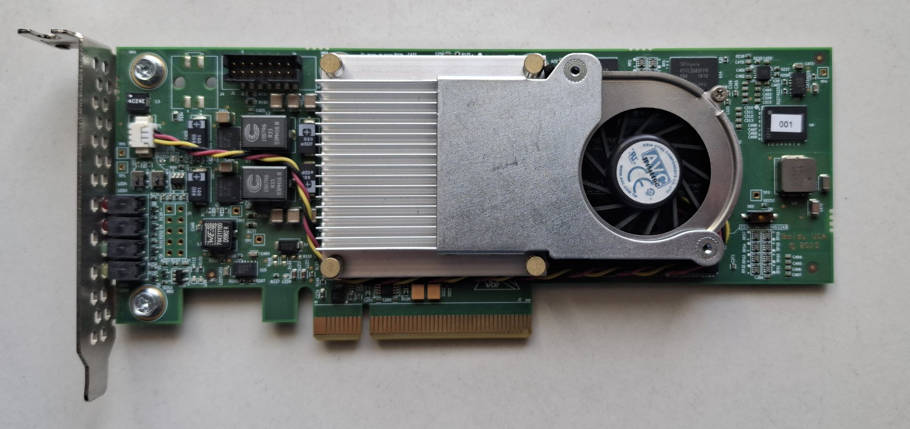
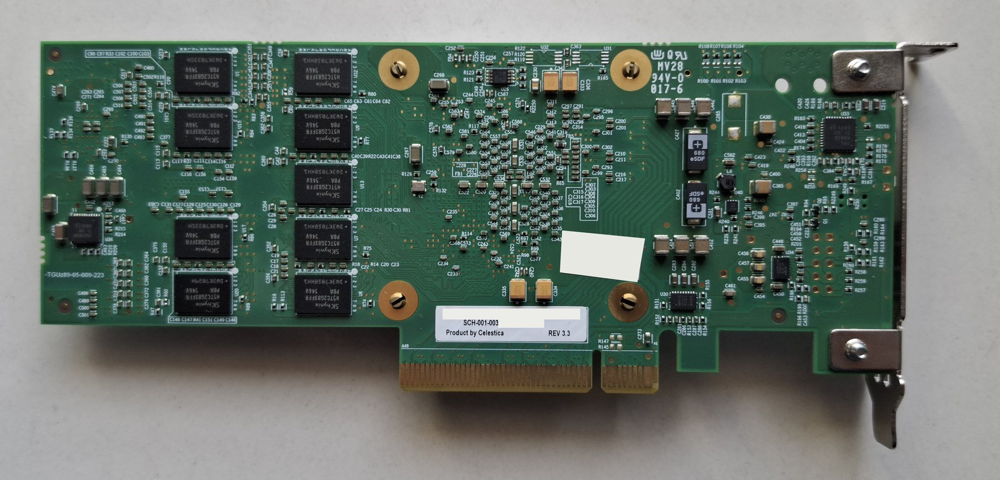

# The card: hardware facts

Everything here was measured on our card or read from its factory design (read-only), unless marked otherwise.

| Front | Back |
|---|---|
|  |  |

**What you can see.** Front: a heatsink and blower fan over the FPGA, the 2×7 JTAG header at the top left, the
LEDs at the bracket, "Baidu USA © 2015" on the silkscreen. Back: nine of the DDR3 chips and a label "SCH-001-003,
Product by Celestica, REV 3.3" (serial number and a seller's sticker blanked out in our photo).

## Identity

| | |
|---|---|
| Board | Celestica **DU-PCB-001-003**, also sold as Baidu **SCH-001-003**; PCIe x8 add-in card |
| FPGA pinout | **YPCB-00338-1P1** (same FPGA wiring as the board in [TiferKing/ypcb_00338_1p1_hack](https://github.com/TiferKing/ypcb_00338_1p1_hack) and the litex-boards target `ypcb_00338_1p1`) |
| FPGA | **XC7K480T-2FFG1156I**, JTAG IDCODE `0x23751093` (silicon revision 2) |
| Configuration | Mode pins `010` = **Master BPI x16** |
| Flash | 64 MB parallel NOR (manufacturer/device ID `0x0089` / `0x887E`) |
| Factory design | 18.73 MB uncompressed bitstream at flash address 0, loaded at power-on |
| PCIe ID (factory design) | `10ee:7028`, subsystem `10ee:0007`, class `0x058000` (memory controller), BAR0 2 MB 64-bit |

## Pins

`pins/board.xdc` is the complete constraint file (every pin, commented out: copy the ones you use). It comes from
the YPCB-00338-1P1 pinout, checked against a JTAG readback of the running factory design: the factory design uses
297 pins (both DDR3 channels = 234 pins, 12 VREF, 45 flash, plus AA28, AH27/28, G25/26, Y26), and all of them
match.

| Function | Pins | Notes |
|---|---|---|
| 50 MHz clock | AA28 | measured 49.998 MHz |
| 200 MHz clock | AH27 / AH28 (diff) | measured 199.993 MHz; LiteX uses this one |
| 200 MHz clock | G25 / G26 (diff) | measured 199.993 MHz |
| PCIe refclk 100 MHz | J8 / J7 = MGTREFCLK0_116 | shared with quad 115 (see [pcie.md](pcie.md)) |
| PCIe PERST# | Y26 | LVCMOS18, needs a pull-up; reads high when idle |
| PCIe lanes 0–7 | TX F2/H2/K2/M2/N4/P2/T2/U4, RX H6/J4/K6/L4/M6/P6/R4/T6 (P side) | quads 115 + 116, see pcie.md |
| LED3 / LED4 / LED5 | P30 / N30 / M30 | LED4 is yellow; LED6 is always on (not FPGA) |
| DDR3 channel 0 | banks 11, 12, 13 | 9 byte lanes (8 data + ECC) |
| DDR3 channel 1 | banks 16, 17, 18 | 9 byte lanes |
| Flash | CE# V30, OE# T33, WE# T34, ADV# M31, address/data in banks 14/15 | LVCMOS18 |

LED pins read low with both pull-up and pull-down: the board pulls them low. The factory design never drives
them. Other idle-high pins in a passive scan: R28, N24, N25, P25, R26, R27.

## The unused-pin trap

nextpnr writes no settings for unused pins, and all-zero I/O settings mean *pull-down*. On this card some pin
stops the FPGA's startup when pulled down: the bitstream loads without error, but `openFPGALoader` reports
`init 0 done 0` and the status register settles at `0x4001a0c`. A Vivado-built bitstream re-encoded with
prjxray loaded fine; the difference was Vivado's PULLNONE on 354 unused pins.

Fix: `tools/unused_pins.py in.fasm out.fasm` between nextpnr and fasm2frames. It adds `PULLTYPE.NONE`,
`IN_TERM.NONE` and `SLEW.FAST` to every unused pin, plus `STEPDOWN` in banks running at ≤ 1.8 V. (The factory
design itself uses pull-ups on unused pins.)

## Memory

Two independent DDR3 channels, each 64 data bits plus one ECC byte lane, **2 GiB per channel**. The chips are
**SK hynix H5TC2G83FFR-PBA, 2 Gbit x8**, one per byte lane: nine per channel, 18 in total (nine visible on the back,
one on the front; the other eight are presumably under the heatsink and fan). 8 × 2 Gbit = 2 GiB per channel.

- Row/column geometry matches LiteDRAM's `MT41J256M16` class, which our builds use because the litex-boards target
  did when we started; current litex-boards uses `MT41K256M8`, which matches the chips exactly.
- **Voltage:** the factory design and litex-boards both configure these banks as SSTL15 (1.5 V), and we build the
  same way. By SK hynix's part numbering these are DDR3L chips (1.35 V, normally also fine at 1.5 V). We have not
  measured the rail with a meter.

The board has **no DDR3 data-mask (DM) pins**: every write stores a whole 64-byte word, so byte enables are ignored. Anything that writes DRAM must write whole words, or go
through a write-back cache. Details and the working recipe: [ddr3.md](ddr3.md).

## Flash layout (read-only investigation)

We backed up the whole 64 MB with our own read-only design (`pins/flashdump`, write-enable tied high, 0.88 MiB/s,
73 s). The flash holds a single complete factory bitstream (to 17.87 MiB) and is otherwise erased, except for a
small board ID record near the end (at `0x3FC0000`). On this board the configuration data pins are bit-swapped:
each 16-bit flash word is the bit-reverse of the bitstream's 16-bit word.

`openFPGALoader -c digilent_hs3 -b ypcb003381p1 --dump-flash` also works, but slowly (about 6 KB/s). **Don't
interrupt a flash dump**: a dump killed halfway left the flash unbootable until a short, clean read (or a PC power
cycle) reset it.

## Health measurements (2026-10-05, factory design, case fan on)

| Check | Result |
|---|---|
| Status register | `0x4107afc`: DONE, no CRC/ID error, MMCM locked, DCI matched |
| Soak test | 108 samples over 9 minutes, no failures |
| Temperature | levels off at 47.5 °C after ~4 min (unconfigured, idle: 29.4 °C) |
| VCCAUX | 1.796 V |
| **VCCINT / VCCBRAM** | 0.958 V: steady, but just below the 0.970 V datasheet minimum. Within XADC error; check with a multimeter if in doubt |
| PCIe | no errors in 30 minutes; reloading the FPGA with the PC on only ever caused a few *correctable* errors |

Repeat it with `python3 tools/soak_monitor.py out.csv <seconds> <interval>` (needs the XADC patch for
openFPGALoader, see [toolchain-bugs.md](toolchain-bugs.md) #8).

## JTAG

- Loading bitstreams (write-only) works at 30 MHz: ~6 s for the 18.7 MB uncompressed bitstream.
- **Reads at 30 MHz fail** with the HS3's default rising-edge sampling (one-bit slip). Use ≤ 20 MHz, or sample
  TDO on the falling edge (MPSSE read commands with bit 2 set): `mustaqi/fpga_link.py` reads at 30 MHz that way.
- `BSCANE2` USER1/USER2 registers work through this flow; `calc/host/hs3_jtag.py` is a small pyftdi JTAG driver
  for the HS3.
- The FPGA's internal configuration clock (`STARTUPE2.CFGMCLK`) measured 63.6–64.2 MHz on this chip (nominal
  65 MHz), useful for designs that need no board pins.
